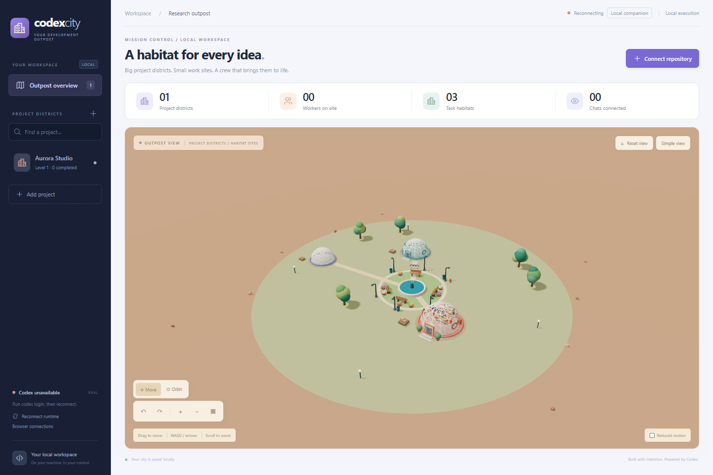
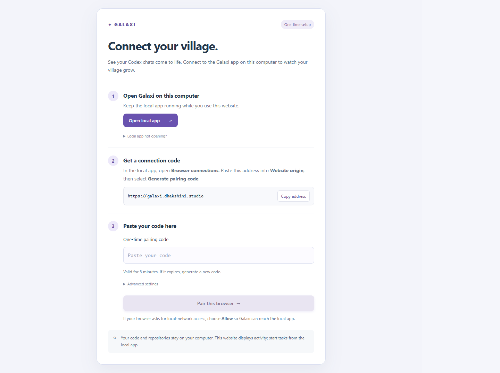

<div align="center">

# Galaxi

### A little world for your big ideas.

A playful 3D village for your Codex projects, with soft colours, glass domes, winding paths and a busy little crew. Watch recorded coding activity become construction, or send prompts from the website to your own local companion.

**[Open Galaxi](https://galaxi.dhakshini.studio)** · **[Download for Windows](https://github.com/srisaidhakshini/galaxi-companion/releases/latest/download/Galaxi-Setup.exe)** · **[Quick start](#quick-start)** · **[Run from source](#run-from-source)**

React · TypeScript · Three.js · Express · SQLite

</div>



_The current website theme, shown with sample project data._

## A habitat for every idea

| Feature                  | What it does                                                                                                                                                       |
| ------------------------ | ------------------------------------------------------------------------------------------------------------------------------------------------------------------ |
| **One chat, one dome**   | Each Codex chat gets a persistent home in its project's village. Later prompts continue the same building.                                                         |
| **Build piece by piece** | Foundations, frames, glass panels, doors, windows, and furniture appear as prompt milestones and recorded construction stages advance. Growth has a cap.           |
| **A working village**    | Workers walk, collect materials, carry, place, and hammer to illustrate observed activity. Trees, streetlights, paths, and a fountain bring the village together.  |
| **Watch existing chats** | Keep prompting in Codex. Galaxi reads recorded activity without submitting another task or taking over approvals.                                                  |
| **Run separate tasks**   | An optional local runner coordinates a lead and isolated implementation workers, checks their results, and leaves application to you.                              |
| **Connect a browser**    | Approve the hosted website in the local companion. View-only is the default; optionally enable prompts that run on your computer. Access expires and is revocable. |

> Construction is a visual interpretation of recorded activity, not a measured percentage of code completion. Watching a chat does not claim that Galaxi ran verification or award verified-task upgrades.

## Windows companion

The Windows x64 companion bundles Node.js, npm and Codex. It adds browser-based sign-in, a project-folder picker and a connection approval window, so end users do not need to clone Galaxi or run setup commands. Git and an eligible Codex account are still required; account usage limits apply.

**[Download Galaxi for Windows](https://github.com/srisaidhakshini/galaxi-companion/releases/latest/download/Galaxi-Setup.exe)** · [Release notes and checksum](https://github.com/srisaidhakshini/galaxi-companion/releases/tag/v0.2.0)

This initial Windows x64 installer is unsigned. See [companion setup and packaging](docs/COMPANION.md) for installation, requirements and verification instructions.

The website screenshots show the new village theme. The published **0.2.0 desktop installer** retains its earlier appearance; it works with the updated website and the same connection permissions.

## Quick start

1. **Install and open the companion.** Download the Windows installer above. Git and your own eligible Codex account are required; Node.js, npm and Codex are bundled.
2. **Sign in and choose a project.** In the companion, select **Sign in with ChatGPT**, then **Connect repository** → **Choose project folder…**. Use an existing Git repository and configure its verification checks.
3. **Connect the website.** Open [Galaxi](https://galaxi.dhakshini.studio) on this computer and select **Connect installed companion**. Verify the website address in the local approval window and choose your browser permission.

Keep the companion running. Use your system's default browser for the installed-app callback; the browser-popup option also works if you prefer another browser. Allow local-network access when prompted.

| Choose your mode                | What happens                                                                                                                                                                                 |
| ------------------------------- | -------------------------------------------------------------------------------------------------------------------------------------------------------------------------------------------- |
| **Watch Codex chat**            | Continue prompting in Codex. Galaxi displays recorded activity without starting another coding task.                                                                                         |
| **Send prompts through Galaxi** | Approve **View activity and send prompts** locally, then submit a separate Galaxi task from the website. Work runs in local worktrees; approvals and applying results stay in the companion. |

Galaxi does not run a developer-funded cloud AI service. Coding uses the user's computer and their own Codex account's eligibility and usage limits. The website alone cannot access a repository without the running, approved companion.

## Run from source

Prerequisites: Node.js **24.x**, npm, Git, and an authenticated Codex CLI on PATH. Windows also needs Windows PowerShell (used for configured verification commands). Tested with Node 24.21.0 and Codex 0.164.0-alpha.11.1.

```powershell
npm ci
codex login
npm run dev
```

Open **http://127.0.0.1:4310**. Use this exact host; the controller deliberately rejects other hosts and origins. The controller launches its own `codex app-server --stdio`, using Codex's existing authentication. No API key needs to be pasted into the application. If already authenticated, skip `codex login`.

Production:

```powershell
npm run build
npm start
```

The production controller serves the built browser bundle and API on the same loopback port. Keep development dependencies installed: `tsx` runs the TypeScript controller. Backend edits require restarting the controller; Vite updates frontend edits automatically.

## Watch work from your existing Codex chat

Select a project and choose **Watch Codex chat**, then pick a chat for that repository. Keep giving prompts in Codex: the city reads its latest recorded prompt, public messages, commands and file edits every two seconds. It does not submit another task, start extra agents, resume the chat, interrupt it, or control its approvals. Choose **Separate Galaxi task** only when you want the independent orchestration runner described above.

Watch connections persist. To attach a known chat when starting the controller, set `CITY_WATCH_THREAD` to its thread UUID. Its repository can be registered for observation without verification commands; such a project is watch-only until checks are configured. Observed work does not award upgrades or claim that Galaxi verification passed. Recorded activity can lag the desktop, and a separate App Server cannot reliably report another client's live turn status. The panel labels this limitation; no missing event is treated as success.

## Run a separate coding task

1. Select **Connect repository** and enter the absolute root of an existing Git repository with at least one commit.
2. Accept detected npm test/lint/typecheck/build scripts or specify trusted verification commands, one per line. Commands must terminate; do not use watch mode. No detected checks means you must supply a meaningful check.
3. Commit any existing uncommitted work yourself. The application refuses dirty checkouts and does not stash or discard changes.
4. Submit a coding prompt. The lead inspects and returns a structured plan; up to two implementation workers run at a time, each in its own worktree.
5. Inspect Chat, Activity, Changes, Checks, and History. Genuine requests appear prominently in the project panel. Steering targets a specific active worker; it does not create another task.
6. Successful execution plus passing controller-run checks upgrades the building once. A successful result is still **not applied** to your original checkout.
7. In Changes, select **Apply verified result…** and confirm. Application uses fast-forward only, and refuses a dirty or moved original branch. Otherwise merge the retained branch yourself after review.

Repository scripts are executable local code. Register repositories and verification commands you trust. Controller verification commands run with your normal account permissions; agent commands use Codex's sandbox and approval policies. Task worktrees do not inherit ignored `node_modules`, virtual environments, or secrets. Give the agent appropriate setup instructions, or configure an explicit setup-and-verification command such as `npm ci; if ($LASTEXITCODE -ne 0) { exit $LASTEXITCODE }; npm test` on Windows. Network requests from agent execution may require approval.

## Connect the hosted website

The [hosted Galaxi website](https://galaxi.dhakshini.studio) connects to the local companion. The companion-enabled website supports no-code approval and optional prompt permission with Galaxi 0.2.0. Your local companion keeps repositories, execution, and Codex authentication on your computer. **Open the website on the same computer as the companion.**

1. Open the installed companion, or start the source version with `npm run dev`.
2. On the website, choose **Connect installed companion** (or **Already running from source? Connect in browser**).
3. Verify the requesting website address in the local approval window. Choose **View activity only** or **View activity and send prompts**, then select **Allow connection**. Allow local-network access if your browser asks.

No manual code copying is needed for this flow. **Manual connection with a code** remains available as a fallback. Codes expire after **5 minutes**; approved browser connections last **8 hours** and can be revoked at any time.

Prompt-enabled browsers can submit, steer and stop tasks in already-registered projects. Repository setup, runtime approvals and applying results stay in the local app. No developer-funded cloud AI service is used; work runs on the user's computer under their own Codex access and limits.

<p align="center">
  
</p>

See [pairing and troubleshooting](docs/PAIRING.md) for browser permissions and [deployment details](docs/DEPLOYMENT.md) for the static hosting boundary. Vercel hosts the frontend; it does not run the local companion.

## Village navigation

Use **Move** to pan by dragging, or **Orbit** to rotate. **WASD** and the **arrow keys** pan while the scene has focus or the pointer is over it; typing in a field does not move the camera. The scene toolbar also offers rotate left/right, zoom, top-down view and reset buttons. Focus a selected project from its panel. Worker badges open the real session details; walking, material carrying and hammering illustrate observed execution states. Enable reduced motion to stop scene animation.

## Configuration

Copy [.env.example](.env.example) to `.env` if needed. The run commands load it. No secrets are required in that file.

- `PORT`: loopback port, default `4310`.
- `CODEX_BIN`: absolute Codex executable path if unavailable on PATH.
- `CITY_DATA_DIR`: database and retained worktree directory, default `.local` relative to launch directory. Keep it outside tracked source.
- `CITY_MODEL`: optional model supported by your Codex account; unset uses the runtime default.
- `CITY_WATCH_THREAD`: optional existing Codex thread UUID to attach in read-only watch mode at startup. Watch selections also persist in SQLite.

Concurrency is selectable per task: one or two implementation workers plus a lead. At most eight subtasks, validated for unique IDs and acyclic dependencies. No automatic retries. Each check has a five-minute timeout; each worker turn has a thirty-minute timeout. A Git operation has a two-minute timeout.

## Persistence and recovery

SQLite initializes automatically; no database service is needed. Schema v1 creates snapshot, event-journal, and exactly-once award tables and sets `PRAGMA user_version=1`. WAL mode is enabled. Back up the data directory while the controller is stopped, **and the connected repositories**: worktrees depend on each repository's Git metadata. Future schema migrations must inspect `user_version`; there are no earlier supported schemas to migrate.

Browser refresh reconnects to authoritative snapshots and replays missing journal events by monotonically increasing ID. On controller restart, uncertain tasks become interrupted and pending runtime requests expire. Workspaces and completed history remain. Retry starts a new attempt from the original branch's current HEAD, rather than guessing whether old work finished. There is no automatic continuation of interrupted runtime threads.

Results live under `.local/workspaces/<task-id>/integration`, with worker worktrees alongside it and branches named `codex/galaxi-<task-id>…`. Retention is intentional. No automatic worktree deletion is implemented. Review/export results before using Git's own `worktree remove` and branch deletion commands; never delete a directory merely because the task failed.

## Structure

- `src/City.tsx`: procedural city, five building levels, scene workers, camera and rendering fallback.
- `src/main.tsx`, `src/style.css`: project console, forms, approvals, replay and responsive layout.
- `src/village-theme.css`, `src/VillageWelcome.tsx`: shared village palette, rounded interface and offline welcome illustration.
- `shared/domain.ts`: renderer-independent entities, lifecycle, dependency validation and completion predicate.
- `server/codex.ts`: stdio App Server JSON-RPC adapter.
- `server/controller.ts`: planning, bounded scheduling, integration, checks and request routing.
- `server/git.ts`: repository validation, worktrees, commits and command execution.
- `server/store.ts`: SQLite snapshots, journal and transactional progression.
- `server/index.ts`: loopback API, SSE invalidations and Vite/static hosting.
- `server/pairing.ts`, `shared/companionPermissions.ts`: local sessions, origin-bound grants, prompt permissions and revocation.
- `src/CompanionPanel.tsx`, `src/companionClient.ts`, `src/connectionHandoff.ts`: connection setup, authenticated transport and one-time callback validation.
- `src/DesktopSetup.tsx`, `desktop/`: desktop sign-in, local approval, folder selection and Windows packaging.

Details: [architecture and lifecycle](docs/ARCHITECTURE.md), [protocol compatibility](docs/CODEX-INTEGRATION.md), [verification and limitations](docs/VERIFICATION.md).

## Verify

```powershell
npm test
npm run build
```

The isolated pairing browser check requires Microsoft Edge and uses sample data without starting real agents:

```powershell
npm run test:pairing
```

Optional checks against the real Codex runtime:

```powershell
npm run spike
npm run test:e2e
```

`npm test` and `npm run build` are deterministic local checks. Spike and E2E use real Codex authentication, consume account usage, and modify only newly created disposable repositories under `.local`. Browser QA requires the app running and Microsoft Edge installed:

```powershell
npm run test:browser
npm run test:browser-execution
```

The browser scripts register a clearly named **QA Workshop** disposable repository in the running city's database. Use a separate `CITY_DATA_DIR` for QA if you want to keep your normal city empty. They assume the default port and a fresh QA history. `test:browser-execution` submits and cancels a real task.

## Current limits

The initial installer targets Windows x64, is unsigned, and does not include automatic updates. macOS, Linux and Windows ARM installers are not provided. Desktop sign-in opens the Codex browser authentication flow; source users can use `codex login`.

Automatic resume after controller restart, MCP elicitation forms, attachment upload, automated dependency installation, manual check editing after project registration, conflict resolution and automatic resource cleanup are not implemented. Conflicts preserve work and block the task; stop it before retrying. Checks are configured at registration; auto-detection currently covers npm scripts only.

The packaged-app and browser tests use isolated sample data. Real sign-in, live coding and clean-machine installer execution are not covered by those automated checks. See [verification and limitations](docs/VERIFICATION.md) for the evidence and scope.

Registered project chats are discovered automatically every 30 seconds, within the eight-chat observation limit. Each chat gets its own dome; selecting it shows that chat's recorded activity. Stop watching is remembered so discovery does not reconnect a chat you stopped. Discovery only reads history and never starts or resumes agents.

## Documentation

| Guide                                          | Contents                                                            |
| ---------------------------------------------- | ------------------------------------------------------------------- |
| [Architecture](docs/ARCHITECTURE.md)           | Domain model, task lifecycle, persistence, and security boundaries. |
| [Codex integration](docs/CODEX-INTEGRATION.md) | App Server protocol and compatibility notes.                        |
| [Windows companion](docs/COMPANION.md)         | Installation, packaging, local execution and release boundaries.    |
| [Browser pairing](docs/PAIRING.md)             | Local approval, expiring codes, permissions, and troubleshooting.   |
| [Deployment](docs/DEPLOYMENT.md)               | Vercel configuration, custom domain, and release process.           |
| [Verification](docs/VERIFICATION.md)           | Tested flows, evidence, and known limitations.                      |
